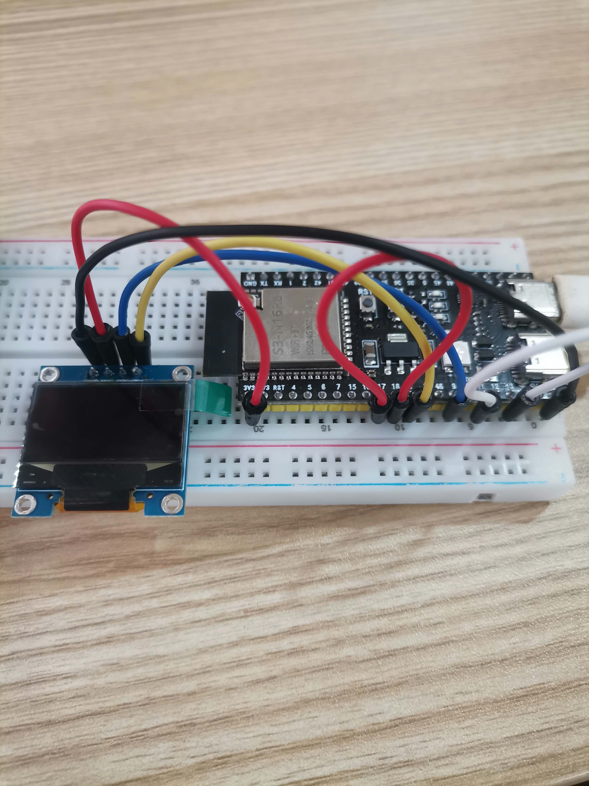
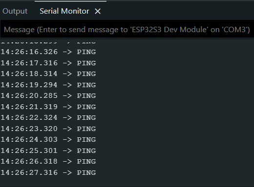
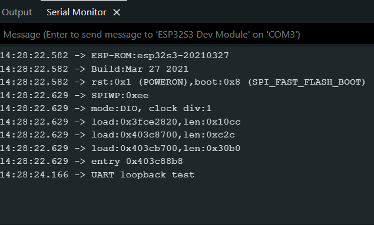
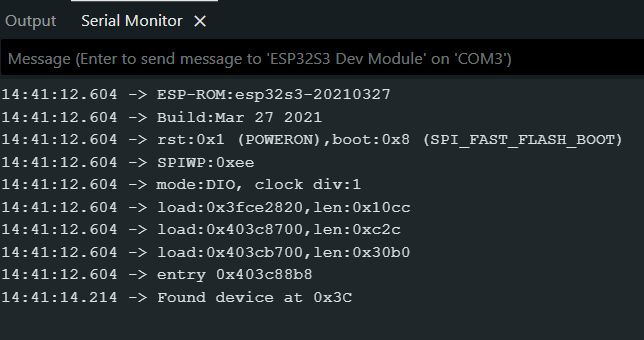
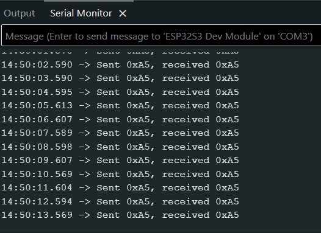
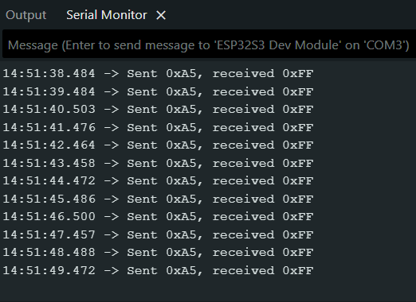

# ESP32-S3 Interface Verification (UART, I²C, SPI)

**Board:** ESP32-S3 (Arduino IDE board: ESP32S3 Dev Module)
**USB port used:** COM3 (write which one: UART/COM port or native USB port)
**I²C module:** SSD1306 0.96" 128x64 OLED (4-pin), address 0x3C

## Pin table

| Signal | GPIO used |
|---|---|
| UART TX (Serial2) | 17 |
| UART RX (Serial2) | 18 |
| I²C SDA | 8 |
| I²C SCL | 9 |
| SPI SCK | 12 |
| SPI MOSI | 11 |
| SPI MISO | 13 |
| SPI CS | 10 |

These pins avoid the strapping pins (0, 3, 45, 46), the flash/PSRAM pins (26-37), the native USB pins (19, 20) and the UART0 pins (43, 44). Each signal has its own pin.

## Wiring

| From (ESP32-S3) | To | Purpose |
|---|---|---|
| GPIO17 (UART TX) | GPIO18 (UART RX) | UART loopback jumper |
| 3V3 | OLED VDD | Power |
| GND | OLED GND | Ground |
| GPIO8 (I²C SDA) | OLED SDA | I²C data |
| GPIO9 (I²C SCL) | OLED SCK (SCL) | I²C clock |
| GPIO11 (SPI MOSI) | GPIO13 (SPI MISO) | SPI loopback jumper |

GPIO12 (SPI SCK) and GPIO10 (SPI CS) are not connected in the loopback test.

The OLED pin order on the module is GND, VDD, SCK (SCL), SDA.



## Sketches

- `uart_loopback/uart_loopback.ino`
- `i2c_scanner/i2c_scanner.ino`
- `spi_loopback/spi_loopback.ino`

## Serial Monitor output

### UART with jumper



### UART without jumper



### I²C with module



### I²C without module

```
No I2C devices found
```

### SPI with jumper



### SPI without jumper



### Baud-rate experiment

- Sketch at 9600, monitor at 115200: The terminal continues to run.
- Sketch at 9600, monitor at 9600: The terminal stopped
- Sketch restored to 115200 afterwards.

## Results

| Test | Expected | Observed |
|---|---|---|
| UART with jumper | PING printed once per second | PING printed once per second, clean text |
| UART without jumper | Nothing received | It only printed "UART loopback test". |
| I²C with module | Found device at 0x3C | Found device at 0x3C |
| I²C without module | No I2C devices found | No I2C devices found |
| SPI with jumper | Sent 0xA5, received 0xA5 | Sent 0xA5, received 0xA5 |
| SPI without jumper | A value other than 0xA5 | A value other than 0xFF |
| Sketch at 9600, monitor at 115200 | Garbled characters | Garbled characters |
| Sketch at 9600, monitor at 9600 | Readable text | Readable text |

## Questions

1. **Why does UART need the same baud rate, while SPI uses a clock line?**
   UART has no clock line, so both devices must use the same speed to read the data correctly. SPI has a clock line that tells the receiver when to read each bit.

2. **Why can two devices with the same address not share one I²C bus?**
   The controller uses addresses to identify devices. If two devices have the same address, the controller cannot tell them apart, which can cause communication errors.

3. **Why is CS set HIGH between SPI transfers?**
   CS is active LOW, so setting it HIGH tells the device that it is not selected. It also marks the end of a transfer and allows another device to be selected.
